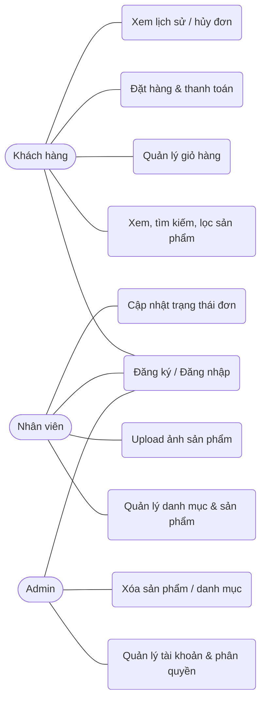
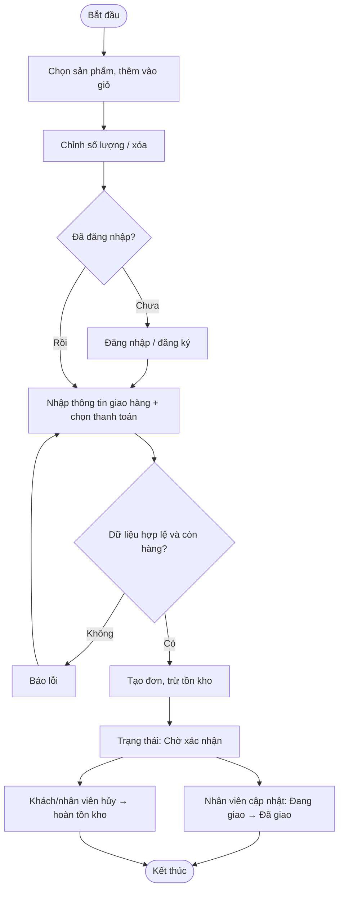
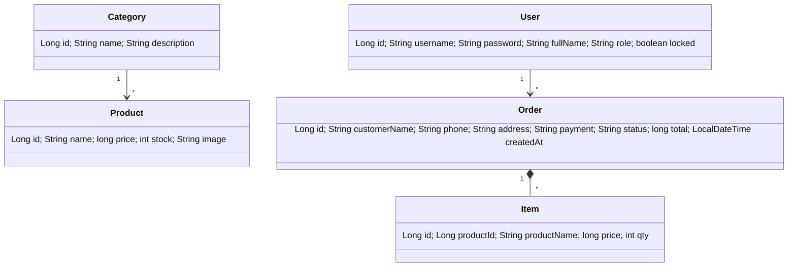

# BÁO CÁO THỰC TẬP – WEBSITE BÁN ĐỒ GIA DỤNG "HOMECARE"

> Các mục đánh dấu **[BẠN ĐIỀN]** cần bổ sung số liệu/ảnh chụp thực tế của bạn (họ tên, đơn vị, ảnh demo, link triển khai...).

## 1. Giới thiệu
- Đề tài: Xây dựng website thương mại điện tử bán đồ gia dụng.
- Đối tượng sử dụng: **Khách hàng** (mua hàng), **Nhân viên** (quản lý sản phẩm, danh mục, đơn hàng), **Admin** (toàn quyền, quản lý tài khoản).
- Link website: **[BẠN ĐIỀN]** • Mã nguồn: **[BẠN ĐIỀN – GitHub]**

## 2. Nguyên tắc thiết kế UI/UX áp dụng
| Nguyên tắc | Cách áp dụng trong website |
|---|---|
| Nhất quán | Dùng chung `site.css` (màu, nút, thẻ, header) cho mọi trang |
| Đơn giản, ít bước | Mua hàng 4 bước: chọn → giỏ → thông tin giao hàng → xác nhận |
| Phản hồi tức thì | Thông báo (toast) sau mỗi thao tác, báo lỗi rõ ràng bằng tiếng Việt |
| Responsive (mobile-first) | Lưới `auto-fill`, breakpoint 760px, bảng cuộn ngang trên mobile |
| Dễ đọc, tương phản | Chữ ≥15px, hỗ trợ chế độ sáng/tối (`prefers-color-scheme`) |
| Phòng lỗi | Kiểm tra dữ liệu ở cả trình duyệt và server; giới hạn số lượng theo tồn kho |

**Phân tích website doanh nghiệp tương tự** (khảo sát các website bán đồ gia dụng/điện máy phổ biến – **[BẠN ĐIỀN tên + ảnh chụp]**), cấu trúc chung: Header (logo, tìm kiếm, giỏ hàng) → Banner khuyến mãi → Danh mục → Sản phẩm nổi bật → Chính sách (giao hàng, bảo hành, đổi trả) → Footer. HomeCare áp dụng cấu trúc này ở 2 landing page (`/` và `/khuyen-mai.html`).

## 3. Công nghệ
| Công nghệ | Vai trò | Trong dự án |
|---|---|---|
| Java Servlet | Nhận request HTTP, trả response | Spring MVC `DispatcherServlet` xử lý (nền tảng chính là Servlet) |
| JSP | Sinh HTML phía server | Dự án dùng HTML+JS gọi REST API (thay JSP) |
| JDBC | Kết nối CSDL | Spring Data JPA/Hibernate chạy trên JDBC |
| SQLite | CSDL quan hệ dạng tệp | Tệp `data/homecare.sqlite`, tự tạo/cập nhật khi ứng dụng khởi động |
| Git/GitHub | Quản lý mã nguồn | Mục 11 |

**Mô hình MVC:** *Model* = `Models.java` (Entity); *View* = `static/*.html`; *Controller* = `Api.java` (REST); tầng truy cập dữ liệu = `Repos.java`.

## 4. Khảo sát & phân tích yêu cầu
**Chức năng theo đối tượng**
- Khách vãng lai: xem, tìm kiếm, lọc sản phẩm; dùng giỏ hàng; đăng ký/đăng nhập.
- Khách hàng: đặt hàng, chọn thanh toán, xem lịch sử, hủy đơn chờ xác nhận.
- Nhân viên: quản lý danh mục, sản phẩm (thêm/sửa/upload ảnh), cập nhật trạng thái đơn, xem thống kê.
- Admin: tất cả của nhân viên + xóa sản phẩm/danh mục + quản lý tài khoản (thêm, sửa, đổi quyền, khóa/mở khóa).

**Yêu cầu phi chức năng:** mật khẩu băm BCrypt; phân quyền ở server; phản hồi nhanh (index `category_id`, nén gzip); giao diện responsive; ảnh ≤2MB (JPG/PNG/WEBP).

**Quy tắc nghiệp vụ:** giá đơn hàng tính ở server; đặt hàng trừ tồn kho; hủy đơn hoàn tồn kho; đơn "Đã giao/Đã hủy" không đổi trạng thái nữa; khách chỉ hủy đơn "Chờ xác nhận" của mình; tài khoản bị khóa không đăng nhập được; danh mục còn sản phẩm không được xóa.

## 5. Sơ đồ thiết kế (Mermaid – hiển thị trực tiếp trên GitHub)
### 5.1 Use Case

### 5.2 Activity Diagram – Quy trình đặt hàng

### 5.3 Class Diagram

### 5.4 ERD
```mermaid
erDiagram
  USERS ||--o{ ORDERS : "đặt"
  CATEGORIES ||--o{ PRODUCTS : "chứa"
  ORDERS ||--|{ ORDER_ITEMS : "gồm"
  PRODUCTS ||--o{ ORDER_ITEMS : "được mua"
  USERS { bigint id PK; varchar username UK; varchar password; varchar full_name; varchar role; bit locked }
  CATEGORIES { bigint id PK; varchar name UK; varchar description }
  PRODUCTS { bigint id PK; varchar name; varchar description; bigint price; int stock; varchar image; bigint category_id FK }
  ORDERS { bigint id PK; bigint user_id FK; varchar customer_name; varchar phone; varchar address; varchar payment; varchar status; bigint total; datetime created_at }
  ORDER_ITEMS { bigint id PK; bigint order_id FK; bigint product_id; varchar product_name; bigint price; int qty }
```

## 6. Wireframe các trang chính
```
[Landing]  Header: Logo | Trang chủ | Khuyến mãi | Cửa hàng
           HERO: tiêu đề + nút "Mua sắm ngay"      | ảnh/emoji lớn
           3 ô lợi ích (giao nhanh / bảo hành / thanh toán)
           4 sản phẩm nổi bật  →  Footer
[Cửa hàng] Ô tìm kiếm | Sắp xếp giá
           [Tất cả][Nhà bếp][Điện gia dụng]...   (lọc danh mục)
           Lưới thẻ: ảnh / tên / danh mục / giá / [Thêm vào giỏ]
[Giỏ hàng] Bảng: sản phẩm | đơn giá | SL (sửa) | thành tiền | Xóa → Tổng → Form giao hàng → [Xác nhận]
[Quản trị] Thống kê | Danh mục (CRUD) | Sản phẩm (CRUD + upload ảnh) | Tài khoản (Admin)
```
**[BẠN ĐIỀN]** chèn ảnh chụp giao diện thực tế vào đây.

## 7. Danh sách API
| Nhóm | Endpoint | Quyền |
|---|---|---|
| Auth | `POST /api/register`, `/login`, `/logout`; `GET /api/me` | Công khai / đã đăng nhập |
| Danh mục | `GET /api/categories` (công khai); `POST/PUT` (Staff, Admin); `DELETE` (Admin) | |
| Sản phẩm | `GET /api/products?category=&q=`; `POST/PUT`, `POST /{id}/image` (Staff, Admin); `DELETE` (Admin) | |
| Đơn hàng | `POST/GET /api/orders`; `PUT /api/orders/{id}/status`; `GET /api/stats` | Khách / Staff, Admin |
| Tài khoản | `GET/POST/PUT /api/users`; `PUT /api/users/{id}/lock` | Admin |

## 8. Kế hoạch & kết quả kiểm thử
Tự động: `mvn test` (JUnit + MockMvc, 15 test). Thủ công:
| # | Kịch bản | Kết quả mong đợi | Kết quả thực tế |
|---|---|---|---|
| 1 | Đăng ký tên < 4 ký tự / mật khẩu < 6 | Báo lỗi 400 | **[điền]** |
| 2 | Đăng ký trùng tên | Báo lỗi 409 | **[điền]** |
| 3 | Khách vào `/api/users` | 403 | **[điền]** |
| 4 | Khóa tài khoản rồi đăng nhập | 403, không vào được | **[điền]** |
| 5 | Thêm sản phẩm giá âm / danh mục không tồn tại | 400 | **[điền]** |
| 6 | Upload file .txt làm ảnh | 400 | **[điền]** |
| 7 | Đặt hàng vượt tồn kho / SĐT sai | 400 | **[điền]** |
| 8 | Đặt hàng → Đang giao → Đã giao | Cập nhật đúng, tồn kho giảm | **[điền]** |
| 9 | Khách hủy đơn chờ xác nhận | Hoàn tồn kho | **[điền]** |
| 10 | Mở trên điện thoại (375px) | Không vỡ giao diện | **[điền]** |

## 9. Tối ưu & bảo mật
Index `category_id`; truy vấn lọc/tìm ở DB; nén gzip; ảnh `loading="lazy"`; BCrypt; chống XSS (escape HTML); upload kiểm tra loại file + tên ngẫu nhiên; giá tính phía server; `@Transactional` cho đặt/hủy đơn.

## 10. Triển khai (Deployment)
1. Đẩy code lên GitHub.
2. Chọn nền tảng hỗ trợ Docker/Java (ví dụ Render, Railway, Fly.io…) → tạo Web Service từ repo, dùng `Dockerfile` có sẵn.
3. SQLite được lưu trong `data/homecare.sqlite`; khi triển khai bằng Docker, volume `sqlite-data` giữ tệp dữ liệu qua các lần khởi động lại.
4. Lưu ý: ổ đĩa của nhiều gói miễn phí không bền – ảnh tải lên và tệp SQLite có thể mất nếu không dùng ổ đĩa/volume bền vững.
5. Chạy local bằng Docker: `docker compose up --build`.
Link online: **[BẠN ĐIỀN]**

## 11. Quy trình Git
- Nhánh: `main` (ổn định) ← `dev` ← `feature/<tên>` (vd `feature/cart`, `feature/upload-image`).
- Commit theo quy ước: `feat:`, `fix:`, `docs:`, `test:` (vd `feat: thêm upload ảnh sản phẩm`).
- Quy trình: tạo nhánh → commit nhỏ → push → Pull Request vào `dev` → review → merge → release vào `main`.
```bash
git checkout -b feature/cart && git add . && git commit -m "feat: giỏ hàng" && git push -u origin feature/cart
```

## 12. Đối chiếu yêu cầu thực tập
| Yêu cầu | Trạng thái |
|---|---|
| Frontend cơ bản, 2 landing page responsive | ✅ `index.html`, `khuyen-mai.html` |
| Ứng dụng frontend có lọc, tìm kiếm, sắp xếp | ✅ `shop.html` |
| CSDL + API cốt lõi + kiểm thử | ✅ `schema.sql`, `Api.java`, `ApiTest.java` |
| Đăng ký/đăng nhập/đăng xuất; quản lý & khóa tài khoản; phân quyền 3 vai trò | ✅ |
| Quản lý danh mục, CRUD + tìm kiếm sản phẩm, upload ảnh, lọc theo danh mục | ✅ |
| Giỏ hàng, đặt hàng, thanh toán (ghi nhận phương thức), quản lý trạng thái, lịch sử | ✅ |
| Sơ đồ Use Case, Activity, Class, ERD, wireframe | ✅ mục 5–6 |
| Tài liệu hướng dẫn sử dụng | ✅ `README.md` |
| Servlet/JSP/JDBC thuần | ⚠️ dùng Spring Boot (chạy trên Servlet + JDBC), không dùng JSP |
| Website chạy online, ảnh demo, số liệu thật, nội dung khảo sát thực tế | ❌ cần bạn thực hiện (mục 10, các ô **[BẠN ĐIỀN]**) |
